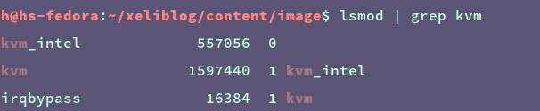

I got new PC (yay!) - obviously not paid, got it for free so it's old and rusty... and not great but I won't complain about it!

Specs
```
h@hs-fedora:~$ lscpu
Architecture:                x86_64
  CPU op-mode(s):            32-bit, 64-bit
Vendor ID:                   GenuineIntel
  Model name:                Intel(R) Core(TM) i5-4670 CPU @ 3.40GHz
 ```

Got 2 4GB memory sticks, so total 8GB.

Currently running on Fedora but also wanted to install Qubes OS later so I double checked if my hardware specs.
Qubes OS minimum specs are as follows: [Qubes OS Min Specs](https://doc.qubes-os.org/en/latest/user/downloading-installing-upgrading/installation-guide.html).
- CPU: 64-bit Intel or AMD processor (also known as x86_64, x64, and AMD64)
- Memory: 6 GB RAM
- Storage: 32 GB free spaces

Phew I do have i5-4670, which includes integrated graphics. So far so good. (will keep update once I start tinkering Qubes finally haha)

Anyhow, back to opnsense story. I installed ISO (dvd) image first since I wanted to use it on fedora boxes. However, it popped with the notification "YOU DON'T HAVE KVM".
My brain immediately goes - "Wait I did heard about KVM, but I don't know what it is until now?!?!". So after small research, I figured it out that it's literally just kernal virtual machine manager, allocating physical resources to VMs.

I had to download default packages first as I didn't have KVM. 
```
sudo dnf install @virtualization
sudo dnf group install --with-optional virtualization
sudo systemctl start libvirtd
sudo systemctl enable libvirtd (to start service on boot)
```
and WHO SAID THIS WILL INSTALL KVM KERNEL MODULE PROPERLY?!
MINE DOES NOT INSTALLS IT AHH


Tried 
```
h@hs-fedora:~$ egrep -c '(vmx|svm)' /proc/cpuinfo
  0
```
so I guess CPU virtualisation feature is not recognised by OS...

TODO: check SVM mode in fedora BIOS
	
	
KA-POW! Found ya.
Now SVM is enabled & got pretty output.

```
h@hs-fedora:~/xeliblog/content/image$ egrep -c '(vmx|svm)' /proc/cpuinfo
  8
```

